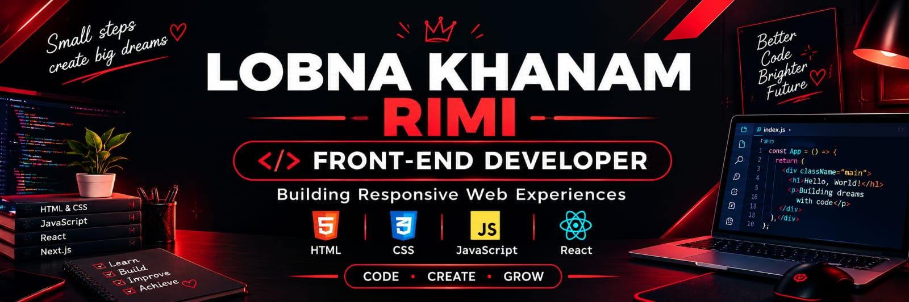

🖤 ABOUT ME

Hello! I'm Lobna Khanam Rimi, a Diploma in Computer Engineering student passionate about Front-End Development.

- 💻 Learning to build modern websites.
- 🎨 Interested in clean UI and responsive web design.
- 🌱 Improving my coding skills through practical projects.
- 📚 Exploring JavaScript, React, and Next.js.
- 🚀 Focused on continuous learning and growth.
- 🎯 My goal is to become a professional Front-End Developer.

---

🔥 TECH STACK

🌐 Front-End Development

  
  
  
  
  

🛠️ Tools I Use

  
  
  
  

---

📚 CURRENTLY LEARNING

HTML & CSS           ██████████ Practicing
Responsive Design    ████████░░ Improving
JavaScript           ████░░░░░░ Learning
React                ███░░░░░░░ Exploring
Next.js              ██░░░░░░░░ Exploring

These bars are illustrative, not measured skill ratings.

---

Exploring website structures, visual layouts, and modern design ideas.

📊 GITHUB STATISTICS

---

🎯 MY GOALS

- [x] Start learning Front-End Development
- [x] Practice HTML and CSS
- [ ] Improve JavaScript skills
- [ ] Build more complete web projects
- [ ] Create a professional portfolio
- [ ] Become a professional Front-End Developer

---

📫 CONNECT WITH ME
LinkedIn-https://www.linkedin.com/in/lobna-rimi
Facebook-https://www.facebook.com/lubna.khanm.

Thanks for visiting my profile!

"CODE" 🔴 "CREATE" 🔴 "GROW"

Small steps every day lead to big achievements.

